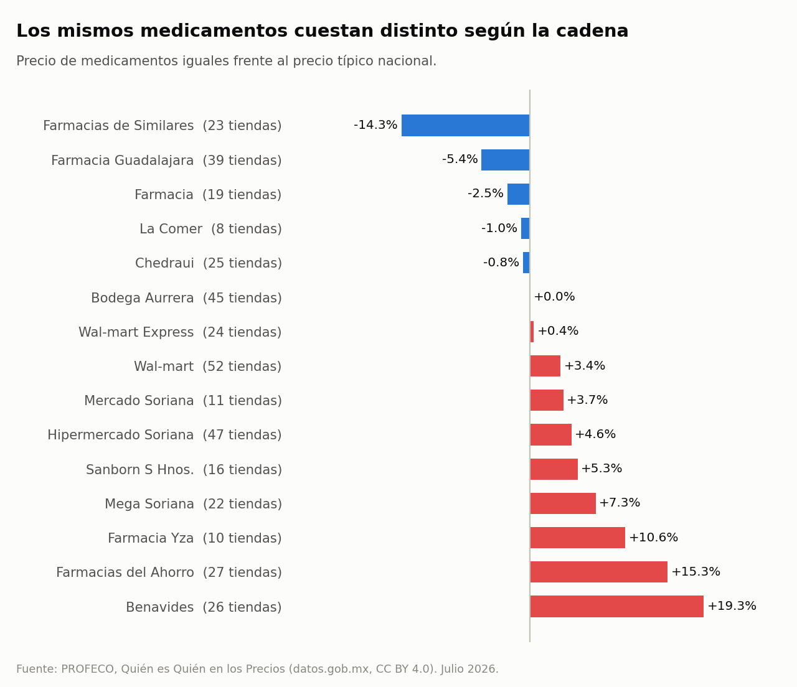
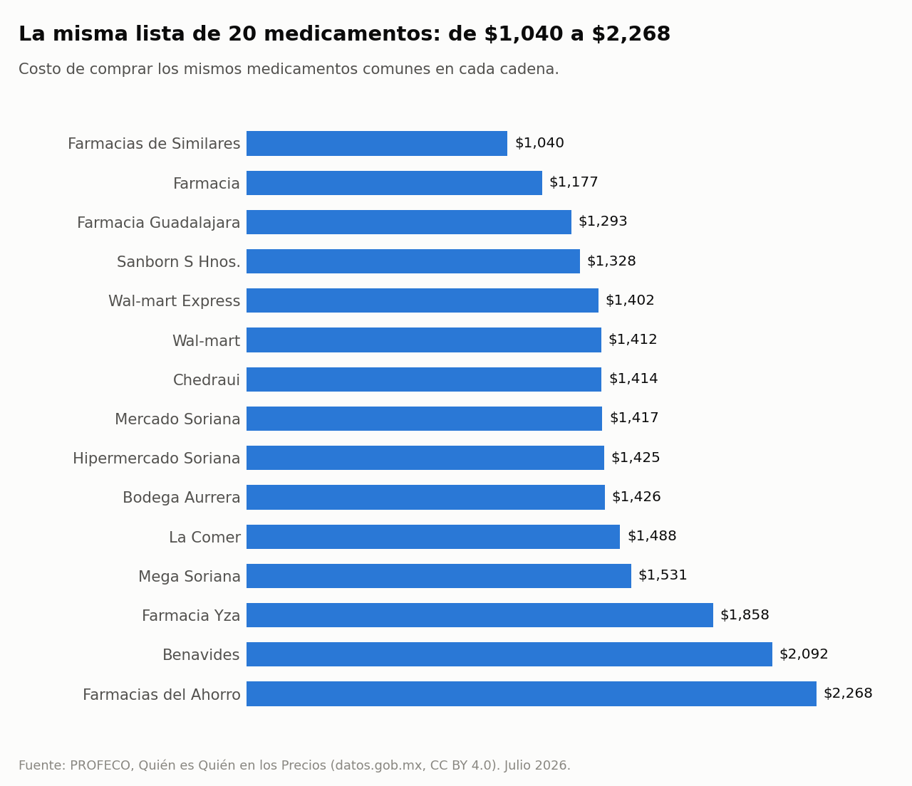

# Farmacias MX

**El mismo medicamento, distinto precio: cuánto cambia según dónde lo compras.**
158 mil precios de medicamentos registrados por PROFECO en julio de 2026.

> **English summary.** Price dispersion of medicines in Mexico using 158,524 price records from PROFECO open data (CC BY 4.0). After cleaning (one median price per medicine per store, typo removal), pandas answers three questions: how much the same medicine varies between stores (typically 37%), which chains are cheaper for the same medicines (a 34-point range), and what the same 20-item list costs in each chain (from MXN 1,040 to MXN 2,268).

## Hallazgos

Segunda quincena de julio de 2026; 486 medicamentos en 545 tiendas.

**1. El mismo medicamento cuesta típicamente 37% más en una tienda cara que en una barata.** En 61% de los 479 medicamentos comparados la diferencia es de 30% o más. En pesos, la diferencia típica es de $98 por caja.

**2. Entre cadenas hay hasta 34 puntos de diferencia.** Farmacias de Similares queda 14% por debajo del precio típico nacional; Benavides, 19% por encima.



**3. La misma lista de 20 medicamentos cuesta más del doble según la cadena:** $1,040 en la más barata y $2,268 en la más cara.



**4. Las mayores diferencias están en genéricos de uso crónico.** Una caja de losartán de 30 tabletas de 50 mg, para la presión, va de $30 en una tienda barata a $172 en una cara.

## Qué significa "el mismo medicamento"

PROFECO registra el nombre del producto y su presentación exacta. Eso implica dos casos:

| Caso | Ejemplo | Qué se compara |
|---|---|---|
| Producto de marca | Tempra, caja con 20 tabletas de 500 mg | La misma caja en todas las tiendas |
| Genérico por sustancia activa | Losartán, caja con 30 tabletas de 50 mg | Misma sustancia, dosis y tamaño; puede ser de laboratorios distintos |

Por eso parte de la diferencia entre cadenas refleja qué laboratorio vende cada una, no solo su margen.

## Método

1. **Limpieza.** De 158,524 filas a 125,559 precios: un precio por medicamento y tienda (mediana de las visitas de la quincena), sin precios en cero y sin errores de captura (más de 3 veces por arriba o por abajo de la mediana del medicamento). Los nombres se unifican quitando acentos, mayúsculas y espacios.
2. **Diferencia entre tiendas.** Percentil 90 frente a percentil 10 de cada medicamento, para que una tienda atípica no decida el resultado. Solo medicamentos en 30 tiendas o más.
3. **Índice por cadena.** Cada precio se divide entre la mediana nacional de ese mismo medicamento (100 = precio típico) y se promedia por cadena. Solo cadenas con 8 tiendas o más y 100 medicamentos comparables.
4. **Lista de 20.** Los 20 productos que venden todas las cadenas grandes (ver [`output/basket_medicines.csv`](output/basket_medicines.csv)), al precio mediano de cada cadena.

## Limitaciones

- **No es una muestra representativa.** Son las tiendas que PROFECO visitó, concentradas en ciertas ciudades.
- **"Farmacia"** agrupa establecimientos que PROFECO no asigna a una cadena.
- **Una quincena.** Incluye promociones temporales.
- **No compara calidad ni laboratorio.** Todos los medicamentos a la venta requieren registro sanitario, pero este análisis no distingue fabricantes.
- **Se descartó comparar farmacias contra supermercados:** la fuente clasifica tiendas de una misma cadena en ambos giros, así que la comparación no era confiable.
- Los precios son de referencia y pueden no coincidir con el precio vigente al comprar.

## Reproducirlo

```bash
pip install -r requirements.txt
python -m farmacias
python -m pytest
```

Los datos ya vienen en `data/` (comprimidos). Para descargarlos de nuevo desde la API: `python -m farmacias.data`.

## Fuente y licencia

Datos: [Programa Quién es Quién en los Precios 2026](https://www.datos.gob.mx/dataset/programa_quien_es_quien_precios_2026), PROFECO, vía datos.gob.mx, licencia CC BY 4.0. Proyecto independiente, sin afiliación con PROFECO ni con ninguna cadena. No es consejo médico: consulta a tu médico antes de cambiar de medicamento.

Código bajo licencia MIT.
